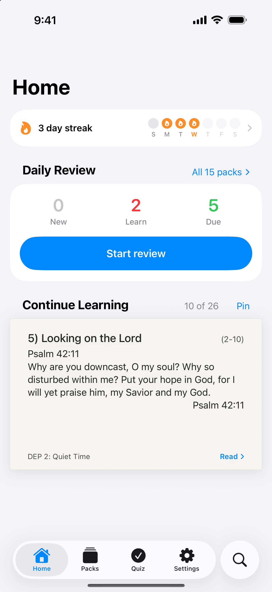
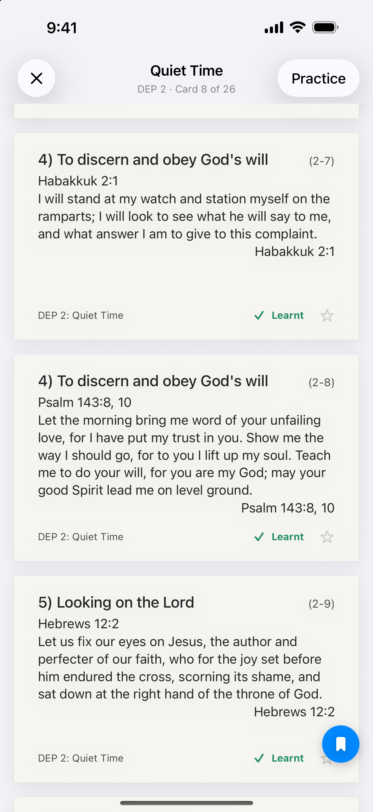
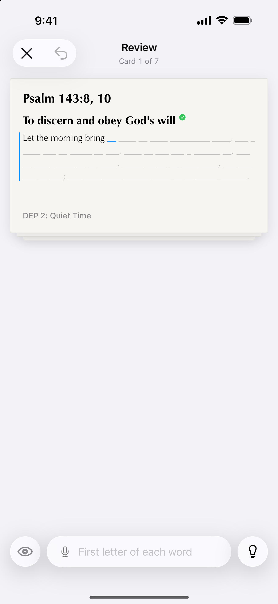
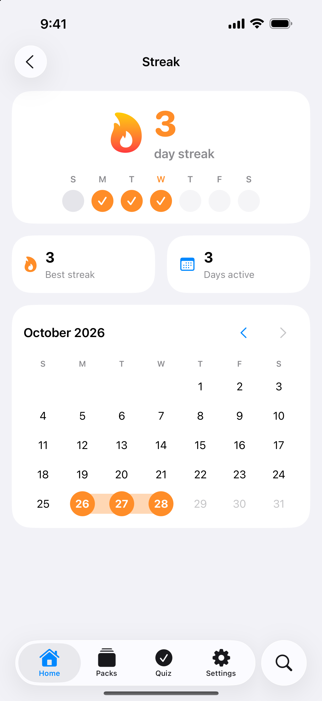

# Scripture Memory

Memorize Bible verses a few minutes a day. The app shows each verse again just before you'd forget it.

<table>
  <tr>
    <td></td>
    <td></td>
    <td></td>
    <td></td>
  </tr>
</table>

## What you get

- **487 verses in 15 packs** from The Navigators: Topical Memory System (TMS 60 and TMS 180), Design for Discipleship, and 5 Assurances.
- **A daily review** that picks which verses are due. Rate each one Again, Hard, Good or Easy, like Anki.
- **Practice your way.** Type the first letter of each word, every word, or the whole verse, or say it out loud.
- **Search** any verse by reference or words.
- **NIV 1984 or NIV 2011**, switch any time.
- **Streaks, reminders and home-screen widgets.**
- **iCloud sync**, with no account.

## Privacy

No accounts, ads or tracking. Your verses and progress stay on your device and in your iCloud. The app sends anonymous usage stats (which screens are used, never your verses) through [TelemetryDeck](https://telemetrydeck.com). Turn it off in Settings › Privacy › Share Anonymous Usage.

## Build it yourself

Needs Xcode 27 and iOS 17 or later.

```bash
git clone https://github.com/joelwongjy/scripture_memory.git
open scripture_memory/"Scripture Memory.xcodeproj"
```

Run the **Scripture Memory** scheme. To run on a device, set your own team under *Signing & Capabilities*. `swift test` runs the scheduling and diffing tests without Xcode.

## License

The code is MIT ([LICENSE](LICENSE)). Scripture text (NIV) and The Navigators' material belong to their copyright holders. This is an independent project, not affiliated with or endorsed by The Navigators.
