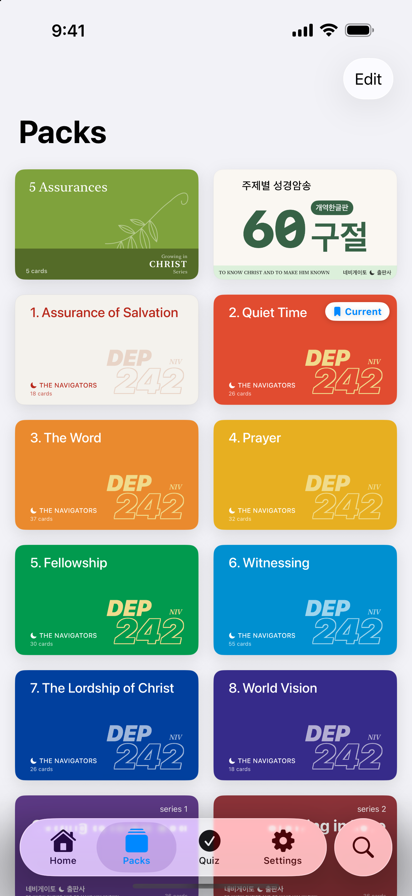
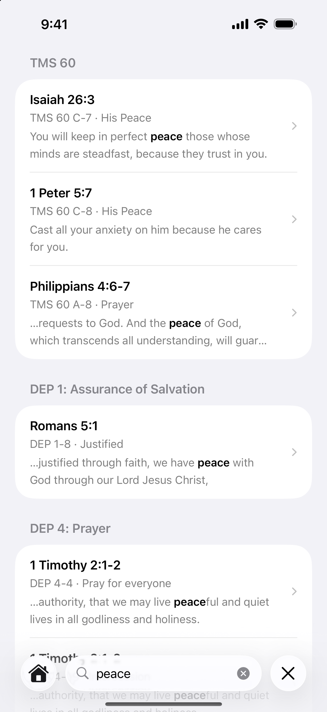
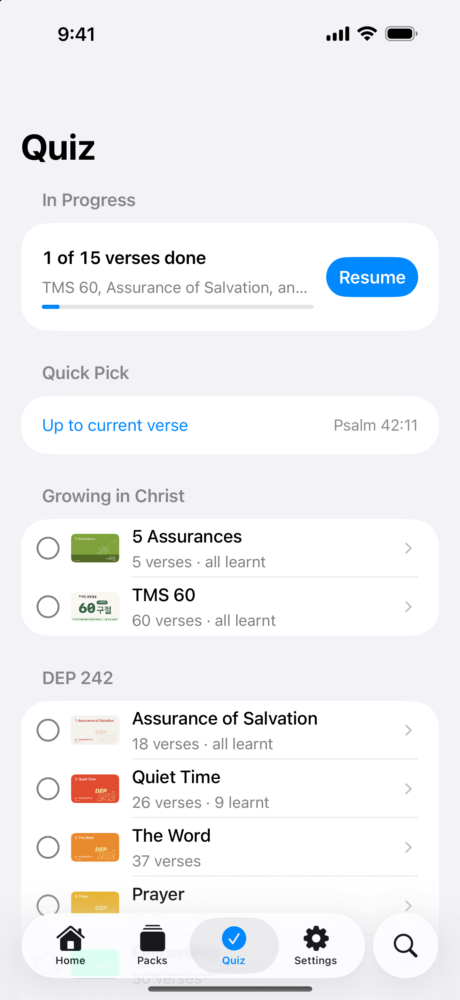

# Scripture Memory

An iOS app for memorizing Bible verses with spaced repetition. Built with SwiftUI.


<br />
[](https://github.com/joelwongjy/scripture_memory/actions/workflows/ci.yml)


[](LICENSE)

## Features

- **Packs as clear pouches.** Each pack opens as a pouch of printed cards. Flip through them one by one, or spread them into a list. On a foldable iPhone the pouch follows the hinge.
- **Anki-style Daily Review.** Today's review shows New, Learn and Due counts, in total and per pack. Rate each verse Again, Hard, Good or Easy with one tap, and Undo if you tap the wrong one.
- **Spaced repetition.** An SM-2 style scheduler decides when each verse is due. Intervals get longer as a verse sticks and shorter when you miss it.
- **Practice modes.** A read mode for studying, plus three recall modes that have you type the verse with increasing difficulty: First Letter, Full Word, and Entire Verse. Hard Mode hides the word blanks.
- **Type or speak.** Recite verses out loud with on-device speech recognition, or type them. Typed answers get a word-level diff marking missing, extra, and wrong words.
- **Search.** A search tab finds any verse by reference or words, and opens it in its pack.
- **Quiz.** Pick packs and a card count for a quick test outside the daily schedule.
- **Streaks and daily limits.** A streak with a week strip and month calendar, a cap on new cards per day or per week, and a daily review cap.
- **Home-screen widgets.** A verse widget and a progress widget, each deep-linking back into the app.
- **Two translations.** NIV 1984 and NIV 2011 for every pack, switchable at any time. Progress is shared across both.
- **iCloud sync.** Review progress syncs across devices. No account required.

## Screenshots

<table>
  <tr>
    <td align="center"></td>
    <td align="center"></td>
    <td align="center"></td>
    <td align="center"></td>
  </tr>
  <tr>
    <td align="center"><sub>Home: streak, today's review, the verse you're learning</sub></td>
    <td align="center"><sub>Packs</sub></td>
    <td align="center"><sub>An open pack</sub></td>
    <td align="center"><sub>Daily Review</sub></td>
  </tr>
  <tr>
    <td align="center"></td>
    <td align="center"></td>
    <td align="center"></td>
    <td></td>
  </tr>
  <tr>
    <td align="center"><sub>Search</sub></td>
    <td align="center"><sub>Choosing packs for a quiz</sub></td>
    <td align="center"><sub>Streak: the week and the month</sub></td>
    <td></td>
  </tr>
</table>

## How spaced repetition works

The scheduler is an SM-2 port in [`SRSAlgorithm.swift`](scripture%20memory/Model/SRSAlgorithm.swift). Each card is in one of two phases:

```
        ┌──────────────┐   Good ×N    ┌────────────┐
  new → │   LEARNING   │ ───────────► │   REVIEW   │
        │ short steps  │  graduate    │ days→weeks │
        └──────┬───────┘              └─────┬──────┘
               │ Again                 Again│ (lapse)
               └◄──────────────────────────┘
```

- **Learning** — the verse moves through short, fixed steps. Again resets it to the first step; Good advances; Easy graduates it straight to review.
- **Review** — the interval is multiplied by the card's ease factor. Good keeps the pace, Hard shortens it, Easy lengthens it, and Again sends the card back to learning with an ease penalty.
- After you recite a verse, its accuracy suggests a grade — a clean recall maps to Good, a few slips to Hard, a miss to Again. You can override it.

Typed answers are compared against the target with a word-level diff ([`DiffEngine.swift`](scripture%20memory/Model/DiffEngine.swift)) based on edit distance. Matching is case- and punctuation-insensitive.

## Content

487 verses across 15 packs, in both translations, from The Navigators' discipleship material:

- **Topical Memory System** — `TMS 60` and the five `TMS 180` series.
- **Design for Discipleship** — 8 packs (`DEP 1`–`DEP 8`).
- **5 Assurances** — a short starter pack.

Verses are stored as JSON: [`verseData.json`](scripture%20memory/Resources/verseData.json) (NIV 1984) and [`verseDataNIV11.json`](scripture%20memory/Resources/verseDataNIV11.json) (NIV 2011). Corrections can be published from Supabase without an app update; see [`supabase/README.md`](supabase/README.md).

## Requirements

- macOS with Xcode 27+ (the pouch uses the iOS 27 SDK hinge APIs, and the app icon is an Icon Composer `.icon`)
- iOS 17+ device or simulator
- Swift 5.9+

The one dependency, [TelemetryDeck](https://github.com/TelemetryDeck/SwiftSDK), is a Swift package that Xcode fetches on first build.

## Build

```bash
git clone https://github.com/joelwongjy/scripture_memory.git
cd scripture_memory
open "Scripture Memory.xcodeproj"
```

Select the **Scripture Memory** scheme and run (`⌘R`).

To run on a device, set your own development team under *Signing & Capabilities*. The app and widget use an App Group and iCloud entitlements, which Xcode can register for you.

## Tests

The scheduling, diffing, tokenizing, and pack-ordering logic lives in a pure-Foundation Swift package (`SRSCore`) with 94 unit tests. It has no UI dependencies, so the suite runs without Xcode or a simulator:

```bash
swift test
```

[CI](.github/workflows/ci.yml) runs this on every push in a `swift:6.0` Linux container, and also builds the app with Xcode 27 on macOS and reports the Release app size.

## Project structure

```
scripture_memory/
├── Package.swift                  # SRSCore — pure logic, Linux-testable
├── Scripture Memory.xcodeproj/    # the iOS app
├── AppInfo.plist                  # app Info.plist (Supabase URL/key for corrections)
├── scripture memory/
│   ├── ScriptureMemoryApp.swift   # entry point
│   ├── Model/                     # scheduler, diff, stores, queues (mostly pure)
│   ├── Views/                     # one folder per screen, plus Shared/
│   │   ├── Home/  Packs/  Search/  Quiz/  Settings/  Onboarding/
│   │   ├── Pouch/                 # a pack opened as a pouch of cards
│   │   ├── TestSession/           # practice, quiz and daily review sessions
│   │   └── Shared/                # cards, controls and pieces used by several screens
│   ├── Utilities/                 # haptics, widget bridge, helpers
│   └── Resources/                 # the verse catalogues (JSON)
├── ScriptureWidget/               # WidgetKit extension (verse + progress widgets)
├── Tests/SRSCoreTests/            # 94 tests against SRSCore
├── Scripts/                       # verse data and Supabase seeding scripts
├── supabase/                      # schema and notes for the verse-corrections catalog
└── docs/screenshots/              # App Store screenshots, also used here
```

The app and widget share data through an App Group: the app writes a snapshot (current verse, streak, due count, weekly activity) and the widget reads it back.

## Privacy

No accounts, no ads and no tracking. Your verses and progress stay on the device (`UserDefaults`) and in your own iCloud.

The app sends two things over the network:

- **Anonymous usage analytics** through [TelemetryDeck](https://telemetrydeck.com): which screens and features are used, with counts sent as ranges. Never verse text, search terms or personal details. It is on by default, and Settings › Privacy › Share Anonymous Usage turns it off. All events are defined in [`AnalyticsEvent.swift`](scripture%20memory/Model/AnalyticsEvent.swift).
- **Verse corrections.** A read-only download that sends nothing about the user.

The App Store privacy label lists Usage Data › Product Interaction and Identifiers › Device ID, both for analytics, not linked to the user, and not used for tracking.

## License

MIT — see [LICENSE](LICENSE). The MIT license covers the application code only. Scripture text (NIV) and the Topical Memory System / Design for Discipleship content remain the property of their respective copyright holders.

## Credits

- Content is based on The Navigators' Topical Memory System and Design for Discipleship. This is an independent project, not affiliated with or endorsed by The Navigators.
- Scripture text: New International Version (NIV), 1984 and 2011 editions.
